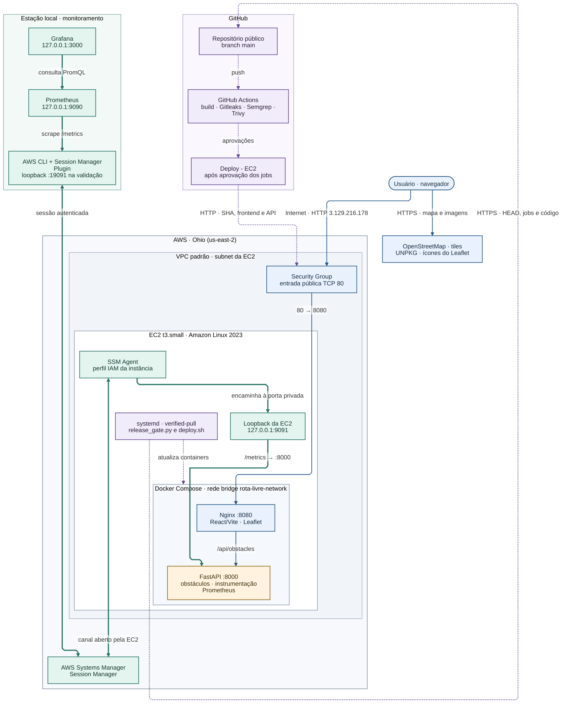

# Arquitetura do ROTA LIVRE

O MVP opera em uma única EC2 na região de Ohio, com o mapa servido por Nginx, a API em rede Docker e a observabilidade em uma estação local. O diagrama representa o fluxo de acesso, a publicação automatizada e a coleta autenticada.

[Mermaid editável](arquitetura.mmd) · [SVG para o PDF](arquitetura.svg)



Linhas contínuas mostram o tráfego da aplicação e dos recursos do mapa. Linhas tracejadas mostram a verificação e a publicação. Linhas espessas mostram a coleta de métricas e as consultas do dashboard. O Security Group representa a política de entrada da EC2.

## Acesso público e rede da aplicação

1. O navegador acessa `http://3.129.216.178/` pela Internet. O Security Group aceita entrada pública TCP 80 e o Docker encaminha o tráfego ao Nginx na porta interna 8080. O acesso público do MVP usa HTTP sem TLS.
2. O Nginx serve os arquivos estáticos React/Vite. O navegador chama `/api/obstacles` na mesma origem e o Nginx encaminha a requisição a `api:8000` pela bridge `rota-livre-network`. A FastAPI devolve os obstáculos de exemplo em JSON. O Security Group restringe a exposição administrativa, incluindo SSH 22, e o host vincula a API à interface de loopback para coleta de métricas.
3. O navegador carrega os tiles do mapa diretamente do OpenStreetMap e os ícones do Leaflet do UNPKG, ambos por HTTPS. [Aplicação](http://3.129.216.178/) · [API](http://3.129.216.178/api/obstacles) · [Frontend](../../frontend/src/App.jsx) · [Nginx](../../frontend/nginx.conf) · [Compose](../../compose.yaml)

## Publicação por verified-pull

1. O push para `main` aciona o workflow. O job `Deploy - EC2` depende de Gitleaks, Semgrep e dos jobs de build e Trivy da API e do frontend. O environment de produção restringe a publicação à branch `main`.
2. Na EC2, o timer do systemd aciona `release_gate.py`. O serviço consulta por HTTPS a referência `main` e a API pública de execuções do GitHub. Ele exige o SHA atual, um push na branch autorizada, a aprovação dos quatro jobs obrigatórios na mesma tentativa e o job de deploy em andamento.
3. O serviço chama `deploy.sh`, que obtém o commit aprovado, constrói as imagens necessárias e atualiza os serviços pelo Docker Compose. O executor serializa a publicação, valida a saúde e prevê recuperação com os IDs das imagens anteriores. O job do GitHub lê `/deploy-revision.txt` e verifica por HTTP o frontend e a API públicos.
4. O fluxo ativo usa consultas públicas ao GitHub e dispensa credenciais AWS armazenadas no GitHub. O Systems Manager foi usado por um operador autorizado para instalar o executor e também atende ao túnel de métricas. A opção de deploy direto por OIDC e Run Command permanece desativada. [Workflow](../../../.github/workflows/devsecops.yml) · [Barreira de release](../../infra/release_gate.py) · [Executor](../../infra/deploy.sh) · [Execução aprovada](https://github.com/victoriafpizza/GlobalSolution2026/actions/runs/43247960515)

## Coleta e visualização

1. A FastAPI instrumenta requisições por método, rota e classe HTTP. O histograma fornece a latência, o contador fornece tráfego e erros, e o coletor do cgroup v2 mede o uso de memória em relação ao limite de 256 MiB da API.
2. O Prometheus consulta `/metrics` pela porta do túnel na estação. O AWS CLI e o Session Manager Plugin abrem uma sessão autenticada com o AWS Systems Manager. O SSM Agent na EC2 usa o perfil IAM da instância e mantém o canal de saída para o serviço. O túnel chega ao loopback `127.0.0.1:9091` da EC2, encaminhado pelo Docker à FastAPI na porta 8000.
3. Na validação com a AWS, a porta local foi `19091` e o Prometheus no Docker Desktop consultou `host.docker.internal:19091`. O procedimento reproduzível também prevê a porta local padrão `9091`. A interface do Prometheus fica no loopback local `127.0.0.1:9090`. O Grafana fica em `127.0.0.1:3000` e consulta o Prometheus por `http://prometheus:9090` na rede do Compose de monitoramento. [Instrumentação](../../backend/metrics.py) · [Configuração do Prometheus](../../monitoring/prometheus/prometheus.yml) · [Procedimento de reprodução](../../monitoring/README.md) · [Captura com dados da EC2](../../evidencias/observabilidade-aws.png)

## Infraestrutura registrada

O Terraform descreve a EC2 `t3.small` com Amazon Linux 2023, subnet na VPC padrão de `us-east-2`, disco EBS gp3 criptografado de 20 GiB, IMDSv2 e perfil IAM para Systems Manager. Os obstáculos de exemplo são definidos no código da API. [Terraform](../../infra/main.tf) · [Perfil IAM](../../infra/ssm.tf) · [Evidências de infraestrutura](../../evidencias/devsecops.md)

## Exportação

A versão SVG usa o layout ELK e texto vetorial. Ela foi gerada a partir do Mermaid, com fundo branco, pelo [Mermaid CLI 11.17.0](https://github.com/mermaid-js/mermaid-cli/releases/tag/11.17.0). Execute o comando abaixo em PowerShell na raiz do repositório para regenerar o SVG.

```powershell
docker run --rm -v "${PWD}/ROTA-LIVRE/docs/arquitetura:/data" minlag/mermaid-cli:11.17.0 -i /data/arquitetura.mmd -o /data/arquitetura.svg -b white
```
