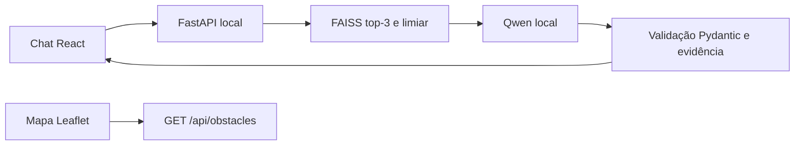
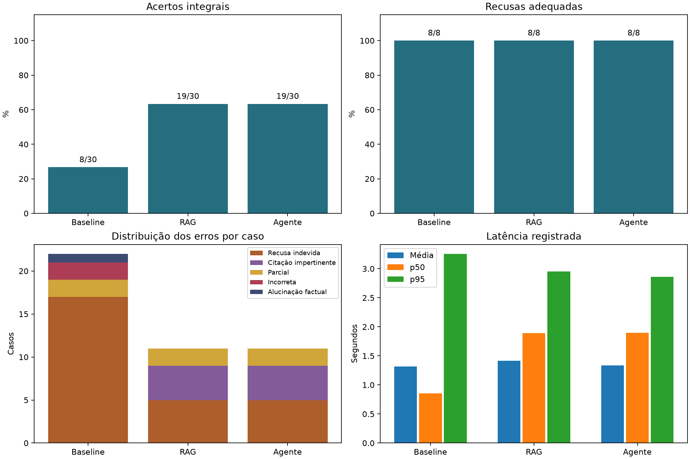

# ROTA LIVRE · Relatório técnico
**FIAP · Global Solution 2026.2 · Generative AI for Engineering**

**Integrantes e RMs da disciplina: preencher após confirmação.**

## Resumo, problema e objetivo

Obstáculos em calçadas, rampas e travessias comprometem a autonomia de pedestres, em especial pessoas com deficiência e mobilidade reduzida. O mapa apresenta registros do MVP. O assistente consulta legislação verificada e oferece orientação geral com fonte ou recusa. Condições em tempo real e garantia de rotas estão fora do escopo.

## Ficha técnica e arquitetura

Windows x64, Python 3.12.14, PyTorch 2.7.1 CPU, Sentence Transformers 4.1.0, FAISS 1.10.0, FastAPI 0.162.2, Uvicorn 0.54.0, Node 24.15.0 e Vite 8.3.7. O modelo Qwen2.5-0.5B-Instruct Q4_K_M roda em llama.cpp b12329, CPU com quatro threads. Consulte os [requisitos](../requirements-entrega.txt) e [a revisão do modelo](../docs/05_geracao_json.md).

O modo agente usa busca, obtenção do chunk, verificação da fonte e validação de evidências. A saída factual é extrativa e recebe citações do catálogo. A pertinência do trecho à pergunta continua sendo uma limitação.

## Dados, recuperação e avaliação

Três leis federais originaram 30 paráfrases segmentadas por unidade de sentido, com IDs, URL, dispositivo e data de verificação. O art. 8º, IV, da Lei nº 9.610/1998 exclui os textos legais da proteção autoral. O catálogo distingue essa exclusão da licença do portal. [Fontes](../base/fontes.json) · [Curadoria e referências](../docs/03_base_documental.md)

O modelo multilíngue MiniLM da revisão `e8f8c211226b894fcb81acc59f3b34ba3efd5f42` produz vetores unitários de 384 dimensões. FAISS IndexFlatIP calcula similaridade cosseno. Recall@1 foi 13/18 (72,22%) e Recall@3, 17/18 (94,44%). O limiar 0,4483887553 foi selecionado exploratoriamente com o próprio conjunto histórico. [Método e candidatos](../avaliacao/analise_limiar.md)

| Histórico | Acerto integral | Factual | Alucinação observada | Citações pertinentes | Latência média |
| --- | ---: | ---: | ---: | ---: | ---: |
| Baseline | 8/30 | 0/18 | 1/5 | N/A | 1,317 s |
| RAG | 19/30 | 9/18 | 0/13 | 9/13 | 1,414 s |
| Agente | 19/30 | 9/18 | 0/13 | 9/13 | 1,337 s |

A comparação usa 90 execuções com o mesmo conjunto e modelo. As taxas de alucinação usam apenas saídas com status respondido. A ausência observada nos modos documentais vale para estes registros e critérios. A verificação adicional do agente manteve o empate no placar. [Auditoria e denominadores](../avaliacao/analise_comparativa.md)

## Diagnósticos e correções

Os casos históricos registram perda do trecho no top-3, seleção impertinente, afirmação sem suporte no baseline, recusa com evidência e esclarecimento genérico. O esclarecimento de percentual agora solicita o item e sugere exemplos. As quatro outras correções permanecem propostas. [Cinco diagnósticos](../avaliacao/cinco_erros_reais.md)

A validação reservada por HTTP obteve 4/4 em RAG e 4/4 no agente, com dois casos factuais, uma recusa e um esclarecimento por modo. O limiar permaneceu fixo. O conjunto é pequeno e inclui uma variação da regressão de esclarecimento. O placar histórico tem outra amostra e permanece separado. [Resultados reservados](../avaliacao/validacao_reservada.json)

## Integração, segurança e LGPD

O chat local preserva o mapa e usa o proxy de mesma origem. A API aceita 600 caracteres, corpo de 4 KiB, um processamento simultâneo e um pedido aceito por segundo por processo. O servidor deve escutar no loopback sem confiar em cabeçalhos de proxy. A rota rejeita origens externas e não habilita CORS entre origens. A chamada de inferência tem timeout de 25 s. A interface avisa para evitar dados pessoais. O backend da demonstração dispensa log de acesso e o gerador da rota opera sem log de perguntas. Respostas de validação e de indisponibilidade são genéricas. Exposição pública exigiria autenticação, limites por identidade, revisão de segurança e definição de base legal e retenção. [Contrato e reprodução](../README.md)

## Custos, limitações e conclusão

A execução medida foi local, em CPU, sem cobrança de API de inferência. O consumo elétrico e o custo operacional não foram medidos. Os pesos locais de embeddings e linguagem ocupam juntos cerca de 962 MB, sem contar dependências e caches. O corpus pequeno e o limiar exploratório limitam a generalização. A integração demonstra orientação documental rastreável, com necessidade de validar pertinência e ampliar o conjunto reservado antes de uso público.

## Reprodução e links

Use o [README](../README.md), os [notebooks executados](../notebooks), os [resultados reservados](../avaliacao/validacao_reservada.json) e o [roteiro verificado no navegador](../docs/roteiro_video.md). O [repositório histórico](https://github.com/victoriafpizza/GlobalSolution2026) e o [repositório da disciplina](https://github.com/victoriafpizza/Generative-AI-for-Engineering) são referências. Esta entrega permanece local. **Vídeo ainda não gravado. Link a preencher após a gravação.**
